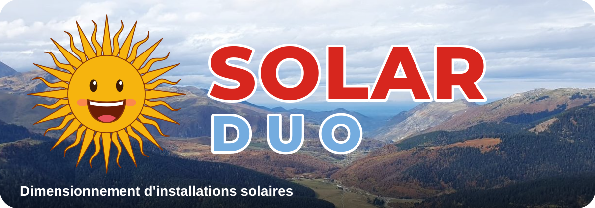

<p align="center"></p>

# Solar Duo

**Dimensionnement d'installations photovoltaïques** — sites isolés avec batteries et installations raccordées au réseau.

Conçu pour les classes de lycée professionnel (bac pro MELEC, CIEL, 2nde MTNE) avec la méthode du cours : bilan énergétique, énergie solaire du mois le plus défavorable, puissance crête avec ηph = 0,75, nombre de modules, capacité des batteries, régulateur, onduleur, câbles et protections selon la NF C 15-100 et le guide UTE C 15-712-2.

- Site : https://deltapassion.github.io/Solar-Duo/
- Version en ligne : https://deltapassion.github.io/Solar-Duo/app/
- Notice : https://deltapassion.github.io/Solar-Duo/notice/
- Téléchargements : [dernière version](https://github.com/Deltapassion/Solar-Duo/releases/latest)

## Fonctions

- Bilan énergétique avec Ku / Ks, veille, appareils types
- Panneaux DualSun et Jinko, chaînes, limite 120 V en site isolé
- Batteries plomb et lithium : C = Ech × J / (U × DoD)
- Régulateurs et onduleurs Victron et Studer jusqu'à 5 kVA
- Sections de câbles et chutes de tension
- Protections Legrand, Schneider, ABB ; schéma unifilaire avec la mise à la terre
- Catalogue technique avec liens vers les fiches des fabricants
- Exemples corrigés : phare de la Caravelle, pavillon F4 à Tarbes, ombrière
- Impression / PDF, enregistrement des projets, français / anglais / espagnol

## Organisation du dépôt

| Dossier / fichier | Contenu |
|---|---|
| `tools/template.html` | **Source de l'application** (HTML, CSS, JavaScript) |
| `tools/build.py` | Assemble `src/solar-duo.html` et `docs/app/index.html` (logo, photo intégrés) |
| `tools/logo/` | Logo (soleil de mai), générateur `gen_logo.py` |
| `main.js`, `preload.js`, `package.json` | Application de bureau (Electron) |
| `build/` | Icônes (`icon.png` 1024 px, `icon.ico`) |
| `docs/` | Site GitHub Pages, notice multilingue, version en ligne |
| `.github/workflows/release.yml` | Compilation automatique Windows, macOS (Intel et Apple Silicon), Linux |

## Développer

```bash
python3 tools/build.py     # après chaque modification de tools/template.html
npm install
npm start                  # lance l'application de bureau
npm run dist               # fabrique l'installable pour le système courant
```

## Publier une version

1. Mettre à jour `NOUVEAUTES.md` (texte de la version).
2. Créer une étiquette `v1.0.1` (GitHub → *Releases* → *Draft a new release* → *Choose a tag* → `v1.0.1` → *Publish*), ou en ligne de commande : `git tag v1.0.1 && git push origin v1.0.1`.
3. L'action **Versions installables** fabrique et joint à la version : `Solar-Duo-Windows-Setup.exe`, `Solar-Duo-Windows.zip`, `Solar-Duo-macOS-AppleSilicon.zip`, `Solar-Duo-macOS-Intel.zip`, `Solar-Duo-x86_64.AppImage`, `solar-duo_amd64.deb`, `Solar-Duo-Linux-x86_64.tar.gz`.

Le numéro de version de l'application est pris dans l'étiquette. Les applications installées signalent la nouvelle version au démarrage.

## Références

NF C 15-100 ; guide UTE C 15-712-2 (installations photovoltaïques autonomes) ; guide UTE C 15-105 ; Guide de l'installation électrique Schneider Electric ; Victron Energy, *Wiring Unlimited* ; fiches techniques DualSun, Jinko Solar, Victron Energy, Studer Innotec, Legrand, Schneider Electric, ABB.

Les résultats sont une aide au dimensionnement : vérifiez les fiches techniques à jour des fabricants et les textes en vigueur avant toute réalisation.

## Licence

© Jacques Branas — [GNU GPL v3](LICENSE). Photo de fond : Payolle (Hautes-Pyrénées).
